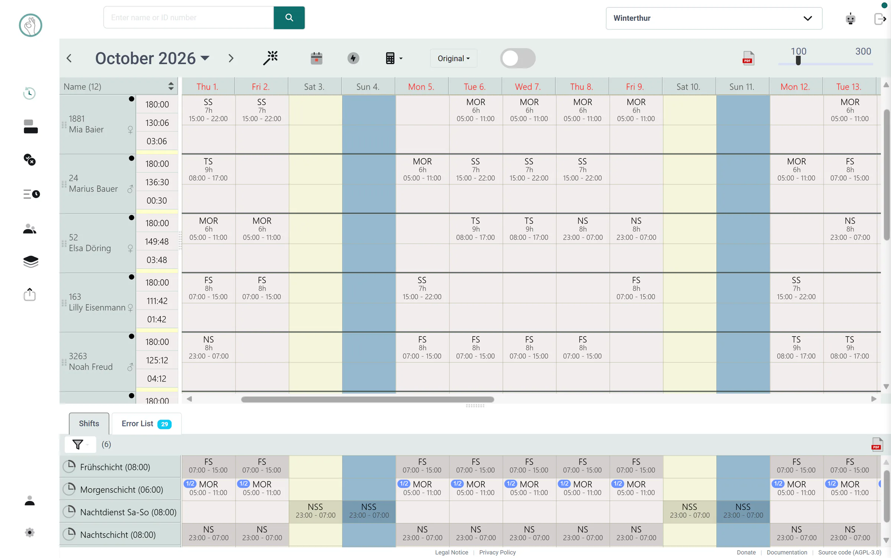
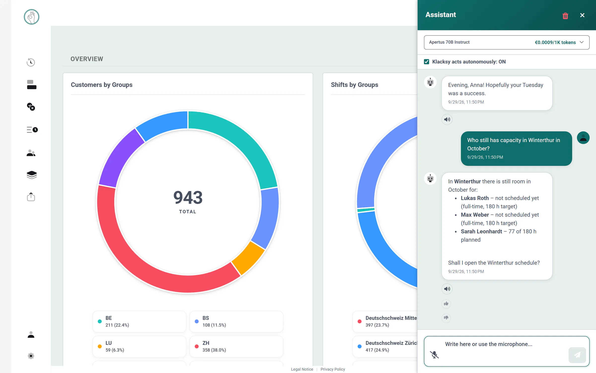

# Klacks

[](https://github.com/HeribertG/Klacks.Api/releases/latest)
[](https://github.com/HeribertG/Klacks.Api/actions/workflows/tests.yml)
[](https://github.com/HeribertG/Klacks.Api/actions/workflows/codeql.yml)
[](LICENSE)

Klacks is open-source workforce scheduling for shift and field operations, for example home care, hospitals, security, cleaning services, logistics and hospitality. You install it on your own server or office PC. An assistant called Klacksy lets you operate it in plain language, with a language model you choose, including one that runs locally.



**Try it without installing anything:** the Playground at <https://play.klacks-software.ch> is a public instance with sample data. Login `admin@test.com`, password `P@ssw0rt1`. It is an admin account; model and provider settings, voice keys, update settings and some assistant functions are disabled on this instance. The data is reset every night, so do not enter real personal data.

This repository contains the backend (`Klacks.Api`, .NET) and is the entry point of the project: releases, issues and discussions live here. The web client lives in [Klacks.Ui](https://github.com/HeribertG/Klacks.Ui).

- Website: <https://klacks-software.ch>
- Documentation: <https://klacks-software.ch/docs/>
- Download: the [Klacks Store](https://klacks-software.ch/store/?culture=en) (see [Install](#install))

## What Klacks does

- **Automatic scheduling.** Builds a schedule for you using an evolutionary algorithm, taking into account working-time limits, qualifications and availability. The result is a proposal that you check and accept.
- **Rule checks.** Flags breaches of rest periods, qualifications, public holidays and surcharges. By default Klacks only warns. A blocking mode can be enabled per rule type; it then also stops automatic planning, accepting a scenario and replacement suggestions. Manual entries stay advisory, except when a mandatory qualification is missing. Surcharges are handled as time credits in hours, not as money.
- **Route and tour optimization.** For mobile operations, using an ant colony algorithm (by car, by bike or on foot).
- **Holidays and rules per country.** Public holidays and rules can be set up per country, region and municipality, and several calendars can be mixed.
- **AI assistant "Klacksy".** Controls the application in natural language, typed or spoken. You choose the language model yourself, from external providers (OpenAI, Anthropic, DeepSeek, Gemini) to a model you run locally.
- **MCP endpoint.** Klacks speaks the Model Context Protocol, so external AI agents can work with it using the rights of the connected user.
- **25 languages.** German, French, Italian and English are built in; 21 more ship as language packs that you install in the settings.



### What Klacks does not do

Klacks is a planning tool. According to the project's own comparison page it has no biometric or fingerprint recognition, no live GPS tracking, no time clock or kiosk terminal, and no payroll accounting (it exports formatted data, for example for DATEV, but does not process payroll).

## Your data and the AI assistant

Klacks runs on your own machine, and staff and scheduling data are stored in your own PostgreSQL database. The assistant is optional: as long as you have not entered an API key or the address of a local model, Klacksy sends no request to a language model.

- **Your choice of model.** A cloud provider, or an OpenAI-compatible server on your own machine or private network, for example Ollama or LM Studio (an address such as `localhost`, `192.168.x.x`, a `.local` name or a single-word host name). Requests to such a server stay in your network and are not pseudonymised.
- **Pseudonymisation before a cloud model, on by default.** Before a request goes to a cloud provider, Klacks replaces the names of known employees, customers and users, their street addresses, phone numbers, e-mail addresses, personnel numbers and birthdates with placeholders such as `MA-0017`. The mapping stays in your installation, and Klacks puts the real values back into the answer.
- **What this does not cover.** The data are pseudonymised, not anonymous. Postcode and town stay readable. Names Klacks does not know (relatives, doctors, people mentioned in a mail) and other free text go along as written. Speech output through a cloud speech service receives the answer with the real names; a local voice is available instead. MCP clients receive results without pseudonyms. Only an administrator can turn pseudonymisation off, through a server setting; there is no switch in the user interface yet.
- **Other external services.** For addresses and routes Klacks calls public OpenStreetMap-based services with addresses, place names or coordinates, without names of persons. You can switch this off with `GEO_NO_OUTBOUND_TRAFFIC=true` or point Klacks to your own instances; see [`deploy/onprem/README.md`](deploy/onprem/README.md). Further optional services (weather, public holidays, translation, web search, speech) are described in the [documentation](https://klacks-software.ch/docs/).

## Install

The supported way to install Klacks is the [Klacks Store](https://klacks-software.ch/store/?culture=en). The package for your country brings its public holidays, working-time limits, surcharges and industry presets.

### Server with Docker (Linux)

You need a host with at least 8 GB RAM and 4 vCPU (the API runs its retrieval models locally), ports 80 and 443 free, and outbound access to `ghcr.io` and `github.com` for images and updates.

Download the ZIP for your country from the Klacks Store, then:

```bash
unzip 'klacks-onprem-*.zip' -d ~/klacks
cd ~/klacks
sudo bash ./install-*.sh
```

Extract into a folder that stays where it is: the automatic updates work with this folder. If Docker is missing, the installer offers to install Docker Engine (Ubuntu, Debian, Fedora, CentOS, RHEL) and asks before it does. It then generates secrets and a self-signed certificate, pins the latest released version, starts the stack and waits until it is healthy. At the end it prints a setup code. Open `https://localhost` and use that code to create your own admin account.

To set the server name: `sudo SERVER_NAME=klacks.example.com bash ./install-*.sh`. Updates are installed by the bundled update service. Rollback, backup and your own certificate are covered in the [documentation](https://klacks-software.ch/docs/).

### Server with Docker Desktop (Windows)

Extract the ZIP into a folder on a local drive (for example `C:\klacks`) and run the bundled script in PowerShell, here for the German package:

```powershell
powershell -ExecutionPolicy Bypass -File .\install-de.ps1 -ServerName klacks.example.com
```

Docker Desktop gives its virtual machine half of the PC's memory, so a PC with 16 GB is recommended. macOS is not supported as a host.

### Single office PC with Windows (no Docker)

For one PC there is a setup that runs without Docker. You get it in the Klacks Store on your country's page and in the [Microsoft Store](https://apps.microsoft.com/store/detail/XPFFW8HDX0KX26). This installation serves the PC it is installed on; if several people plan from different machines, use the server installation.

### What the installer does

The compose file, the installer scripts and the country profiles are in [`deploy/onprem`](deploy/onprem), so you can read what runs on your machine before you start it.

## Project status

Klacks is developed by Heribert Gasparoli in Liebefeld (Switzerland). It is young and looking for its first users outside the author's own environment; the community that is meant to carry the further development is still at the beginning. See [About](https://klacks-software.ch/en/land-gb/ueber-uns).

What you should know before you rely on it:

- Releases are frequent. Tests and CodeQL run on every push to `main` and on every pull request; the badges above show their state.
- The country rule values (working-time limits, holidays, surcharges) are researched, not legally reviewed. Check them against your own contracts and law.
- The 21 language packs are machine-translated and have not been reviewed by native speakers.
- Automatic scheduling is a heuristic: it produces a workable proposal, not a proven optimum.

Bug reports and questions are welcome as [issues](https://github.com/HeribertG/Klacks.Api/issues) and [discussions](https://github.com/HeribertG/Klacks.Api/discussions). Please report security problems as described in [SECURITY.md](SECURITY.md), not in a public issue.

## License

Klacks is licensed under the [GNU Affero General Public License v3.0 only](LICENSE) (AGPL-3.0-only) since 2026-09-28. Versions released up to and including v1.0.35 were published under the MIT license.

There are no license fees. Hosting and operation (servers, maintenance, and an external AI model if you use one) still cost money; what you do not pay is a fee per employee.

If you want to build Klacks into a closed product or keep your changes private, a commercial license is available; see the [license page](https://klacks-software.ch/en/land-gb/lizenz).

## For developers

The API is a .NET 10 application with PostgreSQL, structured along Clean Architecture with CQRS and its own lightweight mediator. Layers, patterns, project structure, build and tests are described in [docs/ARCHITECTURE.md](docs/ARCHITECTURE.md); how to contribute in [CONTRIBUTING.md](https://github.com/HeribertG/.github/blob/main/CONTRIBUTING.md).

The project references sibling repositories. Clone [Klacks.Docs](https://github.com/HeribertG/Klacks.Docs), [Klacks.ScheduleOptimizer](https://github.com/HeribertG/Klacks.ScheduleOptimizer), [Klacks.ScheduleRecovery](https://github.com/HeribertG/Klacks.ScheduleRecovery), [Klacks.Api.SourceGenerators](https://github.com/HeribertG/Klacks.Api.SourceGenerators), [Klacks.Plugin.Contracts](https://github.com/HeribertG/Klacks.Plugin.Contracts) and [Klacks.Plugin.Messaging](https://github.com/HeribertG/Klacks.Plugin.Messaging) next to this one, then build:

```bash
dotnet build Klacks.Api.csproj
```

The unit tests live in the separate repository [Klacks.UnitTest](https://github.com/HeribertG/Klacks.UnitTest).
